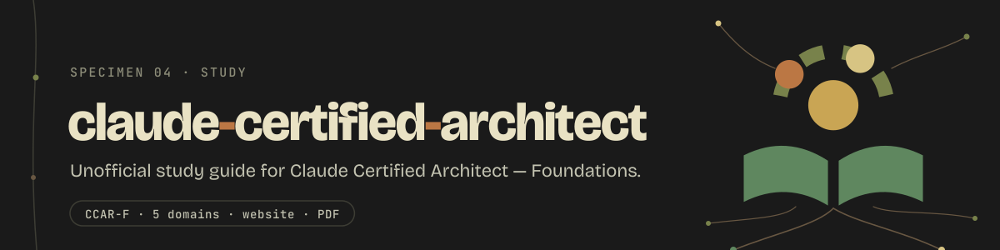

  

  
  
  

  Unofficial study guide for the <b>Claude Certified Architect — Foundations</b> (CCAR-F) exam by Anthropic. 
  All five domains, with detailed explanations, code examples, anti-patterns, decision frameworks, and practice questions.

## Start here

- **Read online** at https://dnacenta.github.io/claude-certified-architect/. Every domain is its own page, and the practice answers stay folded until you've tried the question.
- **Flip through the deck**: [deck_en.pdf](https://dnacenta.github.io/claude-certified-architect/deck_en.pdf), or [in the browser](https://dnacenta.github.io/claude-certified-architect/deck/). It's the visual edition: one idea per slide, diagrams, the exam's traps, practice flashcards and a cheat sheet per domain.
- **Print the full text**: [guide_en.pdf](https://dnacenta.github.io/claude-certified-architect/guide_en.pdf) holds everything in one PDF.
- **Read the source**: start with [claude-certified-architect.md](claude-certified-architect.md), then the [domains](domains/).

All of it is built from this repo's markdown on every push to `main` ([`pages.yml`](.github/workflows/pages.yml)), so nothing drifts from the guide. **Last refresh: 14 October 2026** — see [CHANGELOG.md](CHANGELOG.md) for what changed and when.

## The exam at a glance

| | |
|---|---|
| **Format** | 60 multiple-choice and multiple-response, scenario-based questions in 120 minutes (proctored, closed-book) |
| **Passing score** | 720/1000 |
| **Scenarios** | 4 of 6 randomly selected per exam |
| **Delivery** | Pearson VUE (OnVUE online or test center), registered via the Anthropic Partner Academy |
| **Price / validity** | $125 per attempt; certification valid 12 months, free on-time renewal via a non-proctored assessment (Exam Guide v1.0, effective July 2026) |
| **Who it's for** | Solution architects with 6+ months experience building with Claude APIs, Agent SDK, Claude Code, and MCP; access is gated to the Claude Partner Network |

## What's inside

| Part | Weight | Read it |
|---|---|---|
| **Overview**: the 6 scenarios, the 10 critical anti-patterns, decision frameworks, a 4-week study plan, resources | | [claude-certified-architect.md](claude-certified-architect.md) |
| Domain 1 · Agentic Architecture & Orchestration | 27% | [d1-agentic-architecture.md](domains/d1-agentic-architecture.md) |
| Domain 2 · Tool Design & MCP Integration | 18% | [d2-tool-design-mcp.md](domains/d2-tool-design-mcp.md) |
| Domain 3 · Claude Code Configuration & Workflows | 20% | [d3-claude-code-config.md](domains/d3-claude-code-config.md) |
| Domain 4 · Prompt Engineering & Structured Output | 20% | [d4-prompt-engineering.md](domains/d4-prompt-engineering.md) |
| Domain 5 · Context Management & Reliability | 15% | [d5-context-reliability.md](domains/d5-context-reliability.md) |
| The other three certifications, as overview guides | | [certs/](certs/) |
| The deck's slides and how they're built | | [deck/](deck/) |

## The Claude Certification Family

Anthropic now runs **four** certifications. This repo's deep-dive guide covers CCAR-F; overview guides for the other three (sourced from the official v1.0 exam guides) live in [`certs/`](certs/):

| Code | Credential | Audience | Fee | Guide |
|---|---|---|---|---|
| CCAO-F | Associate — Foundations | Business / productivity users (non-developer) | $99 | [Overview](certs/ccao-f-associate.md) |
| **CCAR-F** | **Architect — Foundations** | **Solution architects** | **$125** | **[Full study guide](claude-certified-architect.md) — this repo's main guide** |
| CCAR-P | Architect — Professional | Senior architects owning the full solution lifecycle | $175 | [Overview](certs/ccar-p-architect-professional.md) |
| CCDV-F | Developer — Foundations | Engineers shipping Claude apps, agents, and workflows | $125 | [Overview](certs/ccdv-f-developer.md) |

Program details: format, renewal, registration, discounts

All four are 120-minute proctored exams delivered via Pearson VUE, passing score 720/1,000, credentials valid 12 months (Exam Guides v1.0, effective July 2026). Renewal is free if done on time: review what changed and pass a non-proctored, open-book assessment; a lapsed credential means sitting the full exam again. Registration needs a partner-domain email — personal addresses are rejected. Delivery moved to Pearson VUE and digital badging to Credly on 2026-06-30. Partner-tier discounts apply at checkout (50% for Select, Preferred, and Global Premier partners; 100% for Global Premier through 2026-12-31), and candidates must be at least 18. Cancelling or rescheduling is free up to 48 hours before the appointment. The Partner Academy FAQ lists the exams and prep content in English and Japanese, and Japanese translations of all four v1.0 exam guides were published on 2026-10-08.

## Model Lineup Used in This Guide

Code samples use **`claude-opus-5-5`** — Anthropic's current default for most workloads (Claude Opus 5.5 launched 2026-09-22). Samples that rely on forced `tool_choice` use `claude-haiku-5-5`, the only current model that still accepts it (Fable 5.1, Opus 5.5, and Sonnet 5.5 return 400).

| Model | ID | Context | Max output | Price (in / out per MTok) |
|-------|-----|---------|-----------|---------------------------|
| Claude Fable 5.1 | `claude-fable-5-1` | 1M | 128k | $10 / $50 (cache reads $0.25) |
| **Claude Opus 5.5** | `claude-opus-5-5` | 1M | 128k | $4 / $20 (cache reads $0.20) |
| Claude Sonnet 5.5 | `claude-sonnet-5-5` | 1M | 128k | $2 / $10 (cache reads $0.10) |
| Claude Haiku 5.5 | `claude-haiku-5-5` | 1M | 128k | $0.10 / $0.50 for prompts up to 100k tokens; $0.50 / $2.50 above |

Legacy, deprecated and retired models

Fable 5, Opus 5, Opus 4.8, 4.7, 4.6, 4.5, Sonnet 5, Sonnet 4.6, and Haiku 4.5 are legacy but still available. Sonnet 4.5 is deprecated and retires on 2026-11-30, with Sonnet 5.5 as its replacement; Opus 4.1 retired on 2026-08-05. Sonnet 5.5 (2026-09-28) and Haiku 5.5 (2026-10-07) completed the 5.5 generation. Fable 5.1, Opus 5.5, and Sonnet 5.5 all reject forced `tool_choice`, bind thinking blocks to the model and history that produced them, and need append-only history; Opus 5.5's thinking can't be disabled, and Sonnet 5.5 replaces `disabled` with `between_tools`. Haiku 5.5 is the odd one out: it still accepts forced `tool_choice` and `disabled`, and it is the only current model whose price rises above a 100k-token prompt. See the [main guide](claude-certified-architect.md#current-model-lineup-october-2026).

## How it stays current

Every week a scheduled refresh checks Anthropic's API release notes, the models, pricing and deprecation pages, the Claude Code changelog and docs, the SDK and MCP changelogs, and the certification program pages. When something exam-relevant changes, it updates the guide, the deck and this README, and records what changed in [CHANGELOG.md](CHANGELOG.md).

## Resources

- [Official CCAR-F Exam Guide (PDF, v1.0)](https://everpath-course-content.s3-accelerate.amazonaws.com/instructor%2F6nizmqk8tpzpfjvt6qmmav7rh%2Fpublic%2F1783542750%2FClaude+Certified+Architect+%E2%80%93+Foundations+Exam+Guide.pdf)
- [Anthropic Partner Academy — CCAR-F registration](https://anthropic-partners.skilljar.com/claude-certified-architect-foundations-certification) · [Prep courses](https://anthropic-partners.skilljar.com/page/claude-certified-architect-foundations-prep-courses) · [Certification FAQ](https://anthropic-partners.skilljar.com/page/faq-certifications)
- [Pearson VUE — Anthropic certification program](https://www.pearsonvue.com/us/en/anthropic.html)
- [Claude API docs](https://platform.claude.com/docs/en/agents-and-tools/tool-use/overview) · [Models overview](https://platform.claude.com/docs/en/models/overview) · [Claude Code docs](https://code.claude.com/docs/en/overview) · [Claude Agent SDK](https://code.claude.com/docs/en/agent-sdk/overview) · [MCP](https://modelcontextprotocol.io/docs/getting-started/intro)
- [Building Effective Agents (Anthropic Engineering)](https://www.anthropic.com/engineering/building-effective-agents)

The [main guide's Resources section](claude-certified-architect.md#resources) has the full, categorized link list. Anthropic split its docs in July 2026: API docs live at `platform.claude.com/docs/en/*`, Claude Code docs at `code.claude.com/docs/en/*`, and the old `docs.anthropic.com/en/docs/*` URLs still redirect. The SDK was renamed from "Claude Code SDK" to the **Claude Agent SDK**.

## Credits

This guide was inspired by and based on the exam breakdown by [@hooeem on X](https://x.com/hooeem/status/2033198345045336559). Full credit to them for compiling the domain coverage, scenarios, and key concepts from the official exam guide.

## Related work

I'm also building open-source tools around persistent agents, structured memory, and Claude Code usage visibility — same problem space as the agentic / MCP / context domains in this guide, different angle:

- **[recall-echo](https://github.com/dnacenta/recall-echo)** — persistent, confidence-weighted memory for coding agents (MCP-friendly). Early but usable.
- **[pulse-null](https://github.com/dnacenta/pulse-null)** — single-binary scaffold for longer-running AI pulses. Research prototype — expect bugs.
- **[pulse-limits](https://github.com/pulse-null/pulse-limits)** — Claude, Codex and Grok plan limits as a living monitor: macOS menu bar, Waybar, terminal. One Rust binary. `brew install pulse-null/tap/pulse-limits && pulse-limits install`. No account, no server — it reuses the logins your CLIs already keep.
- **[pulse-null.com](https://pulse-null.com)** — overview of the work.

Not affiliated with Anthropic or the Claude Certified Architect program. Solo project; stars and issues help.

Feel free to reach out: [dnacenta@pulse-null.com](mailto:dnacenta@pulse-null.com)

## Disclaimer

This is an unofficial community study guide. Claude Certified Architect is a certification program by [Anthropic](https://www.anthropic.com).
