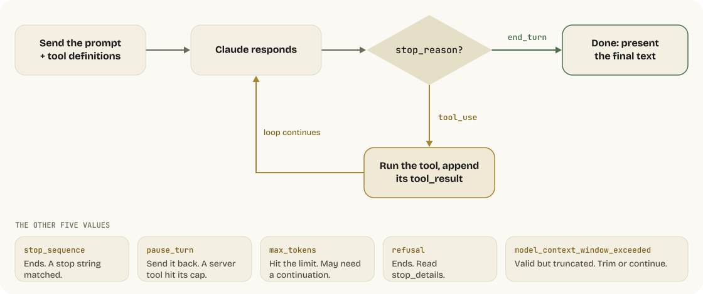
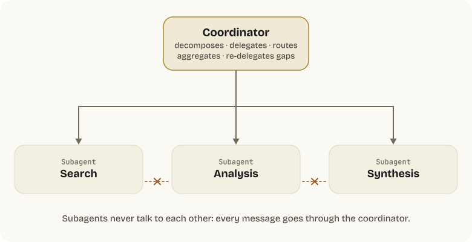
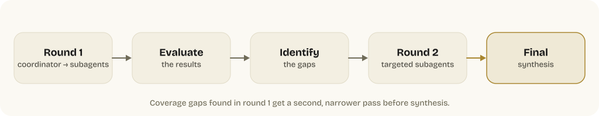
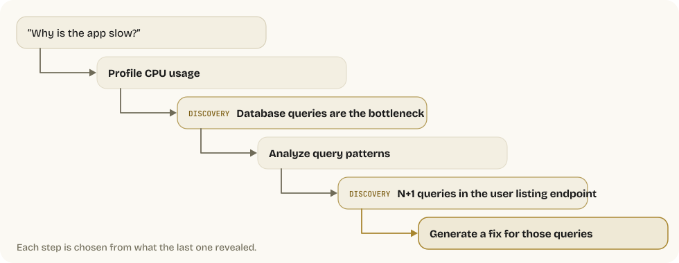

# Domain 1: Agentic Architecture & Orchestration (27%)

The heaviest domain on the exam. Covers 7 task statements focused on how agentic systems are built, how loops operate, how agents coordinate, and how enforcement works.

---

## 1.1 The Agentic Loop Lifecycle

At its core, an agentic system is a loop. Claude receives a prompt with tools, decides whether to call a tool or respond, and the loop continues until Claude signals it's done.

### How the Loop Works

<picture>
  <source media="(prefers-color-scheme: dark)" srcset="../docs/diagrams/agentic-loop-dark.svg">
  
</picture>

### The `stop_reason` Values

| Value | Meaning | Action |
|-------|---------|--------|
| `"tool_use"` | Claude wants to call a tool | Execute it, return result, continue loop |
| `"end_turn"` | Claude has finished reasoning | Present the final text response |
| `"stop_sequence"` | Output matched a configured `stop_sequences` string | Loop ends; inspect which sequence was hit |
| `"pause_turn"` | Server-side tool loop (e.g., web_search) hit its internal iteration limit | Send the response back to continue |
| `"max_tokens"` | Response hit the `max_tokens` limit | May need to request continuation |
| `"refusal"` | Claude declined to respond on safety grounds | Loop ends; inspect `stop_details` (see below), rephrase or route the request |
| `"model_context_window_exceeded"` | Generation hit the model's context window before `max_tokens` | Response is valid but truncated; trim input or continue. Default in Sonnet 4.5+ |

> **`stop_details` on refusals (Opus 4.7+):** A `refusal` response also carries a `stop_details` object (no beta header needed). `stop_details.type` is always `"refusal"`; `stop_details.category` is the policy category (`"cyber"`, `"bio"`, `"frontier_llm"`, `"reasoning_extraction"`, `"general_harms"`, or `null` — the set grows over time); `stop_details.explanation` is a human-readable string (don't parse it). `stop_details` is `null` for every other stop reason. Use the category to route or log specific refusals differently. Since 2026-09-24 a refusal that arrives **before any output is billed** when its category is `bio`, `frontier_llm`, or `reasoning_extraction` (the low-false-positive categories); `cyber`, `general_harms`, and `null` refusals before output are still free. Mid-stream refusals were always billed, and every refusal counts against rate limits.

### Server-Side Refusal Fallbacks

A `refusal` arrives as **HTTP 200**, not an exception — code that reads `content` without checking `stop_reason` first will silently process an empty or partial response. For production agents on Claude Fable 5.1, Fable 5, Opus 5.5, Opus 5, Sonnet 5.5, and Haiku 5.5 (all six ship safety classifiers; Mythos 5.1's safeguards depend on its access program, so handle `refusal` there too), don't just log the refusal: opt into server-side fallback so the request is re-routed automatically by refusal category.

```python
response = client.messages.create(
    model="claude-opus-5-5",
    max_tokens=16000,
    betas=["server-side-fallback-2026-07-01"],
    fallbacks="default",          # server routes by refusal category
    messages=[...],
)
```

`fallbacks="default"` means you never maintain a model list. The older array form (`betas=["server-side-fallback-2026-06-01"]` + `fallbacks=[{"model": "claude-opus-4-8"}]`) still works. Server-side fallback is **Claude API only** — on Bedrock, Vertex, and Foundry use the SDKs' client-side `BetaRefusalFallbackMiddleware` instead.

Two model-specific exceptions. **Haiku 5.5 has no server-side fallback at all**, and its refusals carry no fallback credit — use the SDK middleware or your own retry, and expect to pay the full cache write on the fallback model. **Sonnet 5.5**'s default routing retries `cyber` and `frontier_llm` declines on Sonnet 5 (not `bio`, `reasoning_extraction`, or `general_harms`); a request that sent `thinking: {"type": "between_tools"}` (a value only Sonnet 5.5 accepts) runs its fallback attempt with thinking disabled, so in a manual retry change `thinking` before re-sending.

One consequence on the 5.1 / 5.5 models: a fallback usually lands on a model that cannot read their thinking blocks. The read matrix is now asymmetric:

| Producing model | Read by (besides itself) |
|---|---|
| Fable 5.1 / Mythos 5.1 | Each other only |
| Opus 5.5 | Fable 5.1 / Mythos 5.1, on the Claude API only |
| Sonnet 5.5 | Opus 5.5, on the Claude API and Google Cloud |
| Haiku 5.5 | Opus 5.5 and Sonnet 5.5, on the Claude API and Google Cloud |
| Opus 5 and earlier, Sonnet 5, Haiku 4.5 | Fable 5.1 / Mythos 5.1 and Opus 5.5 (Sonnet 5.5 and Haiku 5.5 read Sonnet 5, Opus 4.8, Haiku 4.5, and older — not Opus 5) |

The API drops unreadable blocks (unbilled), the request succeeds, and the fallback model re-plans without that reasoning — expect a slower, costlier first turn after the switch. Sonnet 5.5 and Haiku 5.5 blocks are also **bound to the account** that produced them: replayed through a different, unlinked account they are dropped the same way. Send the `thinking-binding-controls-2026-08-01` beta header to get an `input_transformations` list of what was dropped (`organization_binding_mismatch` for the account case).

**Loop rule:** always branch on `stop_reason` *before* reading `content`. `refusal` is a terminal stop reason for that request, not a retryable tool error. And on Fable 5.1, Opus 5.5, Sonnet 5.5, and Haiku 5.5, keep the `messages` array **append-only** — editing or snipping earlier turns invalidates every later thinking block (Domain 5 §5.7).

### API Response Structure

When Claude wants to use a tool, the response contains both text and a tool_use block:

```json
{
  "id": "msg_01Aq9w938a90dw8q",
  "model": "claude-opus-5-5",
  "stop_reason": "tool_use",
  "role": "assistant",
  "content": [
    {
      "type": "text",
      "text": "I'll check the current weather in San Francisco for you."
    },
    {
      "type": "tool_use",
      "id": "toolu_01A09q90qw90lq917835lq9",
      "name": "get_weather",
      "input": { "location": "San Francisco, CA", "unit": "celsius" }
    }
  ]
}
```

The `content` array can contain multiple blocks — Claude may explain what it's doing (text) and call a tool (tool_use) in the same response. It can also call multiple tools simultaneously by including multiple tool_use blocks.

### Returning Tool Results

Tool results must reference the exact `tool_use_id` from Claude's request:

```json
{
  "role": "user",
  "content": [
    {
      "type": "tool_result",
      "tool_use_id": "toolu_01A09q90qw90lq917835lq9",
      "content": "15 degrees celsius, partly cloudy"
    }
  ]
}
```

For multiple simultaneous tool calls, return multiple `tool_result` blocks in the same message, each matching its `tool_use_id`.

### Error Results

When a tool execution fails:

```json
{
  "type": "tool_result",
  "tool_use_id": "toolu_01A09q90qw90lq917835lq9",
  "is_error": true,
  "content": "API timeout after 30 seconds"
}
```

Setting `is_error: true` helps Claude understand the tool failed and reason about recovery strategies.

### Model-Driven Decision Making

The exam tests that you understand: **Claude decides** which tool to call and when to stop. You don't pre-configure decision trees or fixed tool sequences. The model reasons about what information it needs, selects the appropriate tool, processes the result, and decides the next step.

This is fundamentally different from traditional workflow automation where steps are predetermined.

### Anti-Patterns (These Are Wrong Answers)

1. **Parsing natural language** for loop termination — "If Claude says 'I'm done', exit the loop." Wrong. Always check `stop_reason`.
2. **Arbitrary iteration caps** as primary stopping — "Run max 5 loops then stop." Wrong as a primary mechanism. You may use safety caps, but `stop_reason` drives the loop.
3. **Checking for text content** as completion — "If the response has text, it's done." Wrong. Responses can contain both text and tool_use blocks.

> **Beyond the exam guide — task budgets (beta):** the modern answer to "how do I bound an agentic loop without a hard iteration cap" is a **task budget**. `output_config.task_budget` gives Claude a token ceiling it can *see*, so it paces itself and finishes gracefully instead of being cut off mid-work. This is different from `max_tokens`, which is an enforced per-response ceiling the model is unaware of.
>
> ```python
> with client.beta.messages.stream(
>     model="claude-opus-5-5", max_tokens=128000,
>     betas=["task-budgets-2026-03-13"],
>     output_config={"effort": "high",
>                    "task_budget": {"type": "tokens", "total": 64000}},
>     messages=[...], tools=[...],
> ) as stream:
>     response = stream.get_final_message()
> ```
>
> Minimum `total` is 20,000. Available on Claude Fable 5.1 / Mythos 5.1, Fable 5 / Mythos 5, Opus 5.5, Opus 5, Sonnet 5.5, Haiku 5.5, and Opus 4.8/4.7 — **not** on Sonnet 5, Opus 4.6, Sonnet 4.6, or Haiku 4.5, and not through Claude Code or Cowork (Messages API only). On Haiku 5.5 it is the documented replacement for the context-awareness tags Haiku 4.5 injected, which the new model no longer receives. Stream it — a large `max_tokens` on a non-streaming request hits HTTP timeouts. Size the budget against your real task-length distribution: a budget that is obviously too small makes Claude decline, scope down, or stop early with a partial result, which looks like a refusal but isn't one. The exam's anti-pattern still holds: a budget paces the loop, `stop_reason` still terminates it.

### Who Runs the Loop: Four Ways to Build an Agent

Two independent questions separate the options: **who supplies the harness** (the loop plus context management) and **who supplies the deployment** (the infrastructure it runs on). Tool Runner and the Claude Agent SDK are easy to conflate because both supply a harness only — you still host them.

| Approach | You write | Harness & deployment | Tools available |
|----------|-----------|----------------------|-----------------|
| **Manual loop** (`client.messages.create`) | The `while stop_reason == "tool_use"` loop | You build the harness; you host | Only tools you define |
| **Tool Runner** (`client.beta.messages.tool_runner`) | Just the tool functions | SDK supplies the loop; you host | Only tools you define |
| **Managed Agents** (beta, `/v1/agents` + `/v1/sessions`) | Agent config + your tool results | Anthropic supplies the loop **and** a per-session sandbox — Anthropic-hosted, or self-hosted on your own infrastructure | Hosted bash / files / code execution, plus Skills, MCP, and your tools |
| **Claude Agent SDK** (`claude-agent-sdk`) | A prompt + options | Claude Code harness + built-in tools; you host | Read/Write/Edit/Bash/Glob/Grep/WebSearch/WebFetch + MCP + subagents |

**Tool Runner ≠ Claude Agent SDK.** Tool Runner ships inside the regular Anthropic SDK (`anthropic` / `@anthropic-ai/sdk`) and only loops over tools *you* define — no built-in tools, no filesystem, no sandbox. It exposes per-turn hooks for approval gates, error interception, result modification (e.g. attaching `cache_control`), and retries. With `stream=True` plus `run_tools_eagerly=True` (Python SDK 1.9.0, 2026-09-28) each tool runs as soon as the model finishes writing its call; `runner.defer_tool_call()` holds a call until your loop body ends. A call that already ran can't be taken back — if the reply is cut short the model never sees its result and may ask again — so defer anything that isn't safe to run twice. The Claude Agent SDK is Claude Code packaged as a library.

**Managed Agents (beta)** is the newest surface and the only one that adds managed *deployment*. The mandatory flow is Agent (created once, versioned, persisted) → Session (one per run). `model`, `system`, and `tools` live on the **agent**, never the session. Each session provisions a container that acts as the agent's workspace and streams events back; you send messages and tool results in. It also adds scheduled deployments (cron-fired sessions), vault-stored credentials substituted at egress, dollar-denominated session budgets, and multi-agent orchestration (below). Beta header: `managed-agents-2026-04-01`. Available on the Claude API and on Claude Platform on AWS (with some differences in features and session behavior); not on Bedrock / Vertex / Foundry — use Claude API + tool use there. The recommended control-plane flow is now the **`ant` CLI**: describe agents, environments, skills, memory stores, deployments, and vaults (CLI v1.34.0+) as files in your repository and run **`ant apply`** (v1.30.0, 2026-09-03), which prints a plan, applies it, and writes a `claude-lock.json` lockfile — commit it so later runs, locally or in CI, update the same resources instead of creating new ones (`ant beta:agents create < agent.yaml` still works for one-offs). Application code owns only the data plane (`sessions.create` with the stored agent ID). `ant auth login` also gives the SDKs an OAuth profile, so a bare `Anthropic()` client works with no API key in the environment. Two September additions: permission policies gained **`auto`** — the server evaluates each agent or MCP tool call and runs it, denies it as high-risk, or pauses for your approval, reporting the verdict in an `evaluation` field on `agent.tool_use` events — and **`ant beta:sessions connect`** attaches your terminal to a live session to follow it, send messages, and approve or deny waiting tool calls (`--web` serves the Console's session viewer locally).

**Multi-agent Managed Agents (2026-10-09).** An agent's `multiagent: {"type": "multiagent_20261001"}` block switches on three things separately: **subagents** (the agent delegates and reads each report; each runs in its own session thread), **dynamic workflows** (the agent writes a program that runs many agents in phases in the background as a *workflow run*, reported through `workflow_run.*` events), and an **advisor** model the primary thread consults mid-turn. Subagents and workflows are on by default; the advisor is off. Both can use agents you list in `predefined_agents` (up to 20 per list) or *inline agents* the agent or workflow defines itself — set `inline_agents` to `{"type": "disabled"}` to restrict them to your list. Delegation is one level deep, a session holds at most 25 child threads, and a workflow run allows 64 threads at once, 1,000 agents over its life, a 24-hour default lifetime, and 10 open runs per session. A run can create more than one thread for the same piece of work, so Anthropic's guidance is to **make the tools your agents call safe to call twice**. The older `coordinator` type is still accepted but can't start workflow runs or define agents itself.

**Web tools got exfiltration controls (2026-10-07).** In Managed Agents, `web_fetch` now fetches only URLs that already appeared in the session (a user message, a `web_search` result, a fetched page); a URL that appears only in Claude's own output, the system prompt, an attachment, or bash / MCP output returns `url_not_in_prior_context`. With `limited` networking, `allowed_hosts` now also restricts `web_search` and `web_fetch`, and a web tool's `allowed_domains` entry outside `allowed_hosts` fails session creation with a 400.

**Choosing:** stay at the simplest tier that works. A single call or a code-controlled workflow handles most tasks; reach for an agent only when the task is genuinely open-ended and model-driven, the value justifies the latency and cost, and errors are catchable (tests, review, rollback).

---

## 1.2 Multi-Agent Orchestration

### Hub-and-Spoke Architecture

The standard pattern for multi-agent systems is hub-and-spoke: one coordinator agent manages multiple specialized subagents.

<picture>
  <source media="(prefers-color-scheme: dark)" srcset="../docs/diagrams/hub-and-spoke-dark.svg">
  
</picture>

### Coordinator Responsibilities

The coordinator:
- **Decomposes** the task into subtasks
- **Delegates** to appropriate subagents
- **Routes** all inter-subagent communication (subagents never talk to each other directly)
- **Aggregates** results from subagents
- **Handles errors** from subagent failures
- **Evaluates** synthesis quality and re-delegates if gaps exist

### Subagent Isolation

**Critical concept:** Subagents have isolated context. They do NOT inherit the coordinator's conversation history. Everything a subagent needs must be explicitly passed in its prompt.

This means:
- The coordinator must include all relevant context in the subagent's task description
- Subagents can't reference earlier parts of the main conversation
- Each subagent starts fresh with only what the coordinator provides

### Dynamic Subagent Selection

Not every query needs every subagent. The coordinator should:
- Assess what the query actually requires
- Only invoke relevant subagents
- Not route everything through a full pipeline

Example: A research query about a single topic doesn't need web search + document analysis + synthesis if a single focused search would suffice.

### Decomposition Risks

**Overly narrow decomposition:** The exam specifically tests this. Example scenario: coordinator is asked to research "creative industries" and decomposes it into only visual arts subtasks, missing music, writing, film, and design.

The fix: broader initial decomposition with explicit coverage checks.

### Iterative Refinement Loops

The coordinator evaluates synthesis output and identifies gaps:

<picture>
  <source media="(prefers-color-scheme: dark)" srcset="../docs/diagrams/refinement-loop-dark.svg">
  
</picture>

---

## 1.3 Subagent Spawning and Context Passing

### The Agent Tool

Subagents are spawned with the **`Agent`** tool — the canonical name in both Claude Code and the Claude Agent SDK. The coordinator must have `Agent` in its allowed tools to spawn subagents, and access can be narrowed to specific subagent types with `Agent(worker, researcher)`.

> **Naming note:** older material (including the exam guide's wording) calls this the **Task** tool. `Task` was Claude Code's original name for the same mechanism; current Claude Code and SDK docs use `Agent`. If an exam item says "Task tool", it means this.
>
> **SDK naming:** the SDK was renamed from "Claude Code SDK" to the **Claude Agent SDK**. Python: `pip install claude-agent-sdk`. TypeScript: `npm install @anthropic-ai/claude-agent-sdk`. Top-level entry point: `query()` + `ClaudeAgentOptions`.

### Context Must Be Explicit

This is tested heavily: **context does not automatically inherit.** When the coordinator spawns a subagent, it must include everything the subagent needs in the prompt.

Bad:
```
"Analyze the customer's issue"
# Subagent has no idea who the customer is or what the issue is
```

Good:
```
"Customer #12345 reported that their order #67890 (placed 2024-01-15,
total $149.99) arrived damaged. They are requesting a full refund.
Analyze the order history and return policy applicability."
```

### Parallel Subagent Execution

To run subagents in parallel, emit multiple `Agent` tool calls in a **single coordinator response**. Not across separate turns — that would be sequential.

```json
{
  "content": [
    {
      "type": "tool_use",
      "name": "Agent",
      "input": { "prompt": "Search for recent papers on...", "subagent_type": "search" }
    },
    {
      "type": "tool_use",
      "name": "Agent",
      "input": { "prompt": "Analyze the document at...", "subagent_type": "analysis" }
    }
  ]
}
```

Claude Code caps concurrent subagents at 20 (`CLAUDE_CODE_MAX_CONCURRENT_SUBAGENTS`) and spawn depth at 3 (`CLAUDE_CODE_MAX_SUBAGENT_SPAWN_DEPTH`); at the depth limit the `Agent` tool is withheld from the subagent (a fork keeps it listed, but it errors instead of spawning). Since v2.1.292 the `Agent` tool also takes a per-call `effort` for non-fork subagents: it overrides the subagent's frontmatter `effort` and persists if the subagent is resumed, while the `CLAUDE_CODE_EFFORT_LEVEL` environment variable still beats both.

> **Beyond the exam guide — when the fan-out outgrows a turn:** Claude Code now has four orchestration units, and the exam's hub-and-spoke reasoning maps onto the first one. The difference is *who holds the plan*.
>
> | | Subagents | Skills | Agent teams (experimental) | Dynamic workflows |
> |---|---|---|---|---|
> | What it is | A worker Claude spawns | Instructions Claude follows | A lead session supervising peer sessions | A JavaScript script the runtime executes |
> | Who decides what runs next | Claude, turn by turn | Claude, following the prompt | The lead agent | The script (`agent()`, `parallel()`, `pipeline()`) |
> | Intermediate results live in | Claude's context | Claude's context | A shared task list | Script variables |
> | Scale | A few delegated tasks per turn | Same | A handful of long-running peers | Dozens to hundreds of agents per run, resumable |
>
> A workflow moves the coordinator's plan out of the model and into code — the deterministic answer to "the coordinator forgot half the subtasks" (§1.2). Claude writes the script; `/workflows` watches it; **ultracode** lets Claude decide when to reach for one — since v2.1.284 it is its own toggle (`/effort ultracode on|off`, or the `ultracode` setting) that stays on at any effort level rather than an effort setting that forced `xhigh`; including the keyword `ultracode` in a single prompt still opts that one task in. Workflows are no longer Claude Code-only: Managed Agents runs them server-side as workflow runs (§1.1). Agent teams need `CLAUDE_CODE_EXPERIMENTAL_AGENT_TEAMS=1`. The medium workflow-size guideline is now 10 agents (was 15), Pro plans default to small, and `CLAUDE_CODE_WORKFLOW_MAX_CONCURRENT_AGENTS` (1–256) raises a run's concurrency cap for inference-bound fan-outs.

### AgentDefinition in the Claude Agent SDK

```python
from claude_agent_sdk import query, ClaudeAgentOptions, AgentDefinition

async for message in query(
    prompt="Use the code-reviewer agent to review this codebase",
    options=ClaudeAgentOptions(
        allowed_tools=["Read", "Glob", "Grep", "Agent"],
        agents={
            "code-reviewer": AgentDefinition(
                description="Expert code reviewer for Python and TypeScript",
                prompt="Analyze code quality, identify bugs, suggest improvements.",
                tools=["Read", "Glob", "Grep"],
            ),
            "test-writer": AgentDefinition(
                description="Test generation specialist",
                prompt="Write comprehensive unit tests for the provided code.",
                tools=["Read", "Write", "Bash"],
            ),
        },
    ),
):
    print(message)
```

Messages emitted from inside a subagent's context carry a `parent_tool_use_id` field — use it to attribute messages to the right subagent execution. The TypeScript SDK's `AgentDefinition` gained `autoCompactWindow` (v0.3.296), so a subagent can auto-compact earlier than the main conversation.

> **Permission-mode default changed (TypeScript Agent SDK v0.3.286):** omitting `permissionMode` no longer means `default`. Claude Code now picks the starting mode — a settings `permissions.defaultMode` if one applies, otherwise the built-in default, which can be **auto mode** (for example on third-party providers or with telemetry off). A session that starts in auto mode drops broad allow rules such as a bare `Bash`. If your app relies on manual approvals through `canUseTool`, pass `permissionMode: "default"` explicitly.

### Forks vs Fresh Subagents

A **fork** is the opposite trade-off from an isolated subagent: it inherits the *entire* conversation — history, system prompt, tools, model — and shares the prompt cache, so it is cheaper than a fresh subagent. Only its final result returns to the main conversation; its tool calls stay isolated. Forks can't spawn sub-forks.

| | Fresh subagent | Fork |
|---|---|---|
| Conversation history | Not inherited — pass everything explicitly | Fully inherited |
| System prompt / tools | The subagent's own | Same as the parent session |
| Prompt cache | Cold | Shared with the parent (cheaper) |
| Use for | Bounded, well-specified tasks; noisy exploration | Divergent branches off a shared baseline |

In Claude Code, Claude requests a fork through the `Agent` tool with `subagent_type: "fork"` (fork mode is on by default in interactive sessions, and subagents it spawns then run in the background). You can start one yourself with `/subtask <prompt>`. Two neighbors are easy to confuse: `/fork` now *copies* the whole session into a separate background session (agent view), and `/branch` switches you into a copy of the conversation to try a different direction. The SDK/CLI also exposes `--fork-session` for resuming a session under a new ID; `fork_session` is the older API-level name for the same "branch from a shared baseline" idea.

### Structured Context Passing

Best practice: separate content from metadata when passing context between agents.

```json
{
  "findings": [
    {
      "claim": "Revenue increased 15% YoY",
      "evidence": "Q4 earnings report, page 3",
      "source_url": "https://example.com/earnings",
      "document_name": "Q4 2024 Earnings Report",
      "publication_date": "2025-01-15"
    }
  ]
}
```

This preserves attribution and allows the receiving agent to evaluate source quality.

---

## 1.4 Workflow Enforcement and Handoff

### The Critical Distinction

This is one of the most heavily tested concepts on the exam:

| Enforcement Type | When to Use | Guarantee Level |
|-----------------|-------------|-----------------|
| **Programmatic** (hooks, prerequisites) | Financial/safety consequences | Deterministic — 100% enforced |
| **Prompt-based** (instructions) | Best-effort acceptable | Probabilistic — non-zero failure rate |

### Example: Financial Operations

Scenario: A customer support agent must verify identity before processing refunds.

**Wrong approach (prompt-based):**
```
"Always verify the customer's identity before processing any refund."
```
This will work most of the time, but has a non-zero failure rate. For financial operations, "most of the time" is not acceptable.

**Correct approach (programmatic):**
A PreToolUse hook on `process_refund` that checks whether `get_customer` has been called and returned a verified customer ID. If not, the hook blocks the refund with exit code 2.

### Handoff to Humans

When an agent escalates to a human, the human agent typically does NOT have access to the full conversation transcript. The handoff must include a structured summary:

```
Customer: Jane Doe (#12345)
Issue: Damaged product received
Order: #67890, $149.99, placed 2024-01-15
Root cause: Shipping damage
Actions taken: Verified order, confirmed damage via photos
Recommended action: Full refund + replacement shipment
Refund amount: $149.99
```

---

## 1.5 Claude Code / Agent SDK Hooks

### Hook Events (Current Catalog)

The hook system expanded substantially in 2026 — the current catalog is **33 events** across eight groups. Exam-relevant ones are marked ★.

| Group | Events |
|-------|--------|
| **Setup** | `Setup` (fires only with `--init-only`, or with `--init` / `--maintenance` in `-p` mode — one-time preparation in CI or scripts, not every session) |
| **Session & turn** | `SessionStart` ★, `SessionEnd` ★, `UserPromptSubmit` ★, `UserPromptExpansion`, `Stop` ★, `StopFailure` |
| **Tool / agentic loop** | `PreToolUse` ★, `PostToolUse` ★, `PostToolUseFailure`, `PostToolBatch`, `PermissionRequest` ★, `PermissionDenied` |
| **Agent & task** | `SubagentStart`, `SubagentStop` ★, `TaskCreated`, `TaskCompleted`, `TeammateIdle` |
| **File & config** | `FileChanged`, `CwdChanged`, `DirectoryAdded`, `ConfigChange`, `InstructionsLoaded` |
| **Compaction** | `PreCompact` ★, `PostCompact` |
| **Model** | `PreModelSwitch`, `PostModelSwitch` (block, confirm, or annotate a model change — new in v2.1.251) |
| **Context & worktree** | `Notification`, `MessageDisplay`, `Elicitation`, `ElicitationResult`, `WorktreeCreate`, `WorktreeRemove` |

The rough lifecycle you should carry into the exam:

```
SessionStart
  → UserPromptSubmit
    → [Agentic Loop]:
        PreToolUse
          → PermissionRequest  (may fire PermissionDenied)
            → PostToolUse  /  PostToolUseFailure
              → SubagentStart / SubagentStop
                → TaskCreated / TaskCompleted
    → Stop  /  StopFailure
  → PreCompact → PostCompact
  → PreModelSwitch → PostModelSwitch   (only when the model changes)
→ SessionEnd
```

### Hook Types

Five types are supported. `mcp_tool` is new in 2026.

| Type | How It Works | Use Case |
|------|--------------|----------|
| `command` | Runs a shell command. Exit 0 = pass, exit 2 = block | File validation, linting gates |
| `http` | POST to a URL endpoint | External audit logging, webhooks |
| `mcp_tool` | Calls a tool on a configured MCP server | Structured validation via a reusable service |
| `prompt` | Single LLM call that returns a yes/no decision | Context-dependent approval |
| `agent` | Multi-turn subagent with tool access | Complex compliance checks |

Two constraints from recent releases: `PermissionRequest` no longer runs `agent`-type hooks — their answer could never allow or deny the request, so use `command` or `http` there (v2.1.280+) — and `mcp_tool` hooks on blocking events wait for their MCP server to finish connecting instead of being skipped. Per the v2.1.299 changelog, `UserPromptSubmit` now runs *before* a skill or custom slash command expands, so a hook that blocks the prompt also stops the skill's embedded shell commands.

### PreToolUse Hooks (Current JSON Shape)

Each matcher holds an **array** of `hooks` (the old singular `hook` field is gone). Hooks can be `async`, gated on `if` permission rules, and carry a `statusMessage` shown in the UI.

```json
{
  "hooks": {
    "PreToolUse": [
      {
        "matcher": "process_refund",
        "hooks": [
          {
            "type": "command",
            "if": "Bash(git *)",
            "command": "\"$CLAUDE_PROJECT_DIR\"/.claude/hooks/check-refund-authorization.sh",
            "timeout": 600,
            "statusMessage": "Verifying refund authorization...",
            "shell": "bash"
          },
          {
            "type": "mcp_tool",
            "server": "compliance",
            "tool": "check_refund_policy",
            "input": { "amount": "${tool_input.amount}" },
            "timeout": 60
          }
        ]
      }
    ]
  },
  "disableAllHooks": false
}
```

**Decision control output (unchanged):**
```json
{
  "hookSpecificOutput": {
    "hookEventName": "PreToolUse",
    "permissionDecision": "deny",
    "permissionDecisionReason": "Customer identity not yet verified",
    "additionalContext": "Call get_customer first to verify identity"
  }
}
```

`permissionDecision` values: `"allow"`, `"deny"`, `"ask"`, and `"defer"` (only in `-p` mode: the tool doesn't run, the process exits with `stop_reason: "tool_deferred"`, and the calling app resumes the session later — ignored if Claude made several tool calls in the turn). When several PreToolUse hooks disagree, precedence is **`deny` > `defer` > `ask` > `allow`**. Deny and ask *permission rules* are still evaluated whatever a hook returns, so a hook's `"allow"` never overrides a matching deny rule, and an `updatedInput` rewrite is checked against those rules as rewritten (a gap where some rules and safety checks missed the rewritten input was closed in v2.1.290).

**Fail closed when it matters.** By default a hook that can't start, times out, exits with a code other than 0 or 2, or prints invalid output is a *non-blocking* error — the action goes ahead, so a policy hook with a typo in its path silently lets everything through. Since v2.1.295, `"onFailure": "block"` on a `command` or `http` hook makes any such failure act like exit code 2 on that event (on `PermissionRequest` it denies the request); the default stays `"continue"`. Separately, since v2.1.288 a PreToolUse or PermissionRequest hook whose matching fails, or whose tool input can't be serialized, blocks the call instead of being skipped. For the exam's "refund must be verified" scenario, a deterministic gate is only deterministic if it also fails closed.

### PostToolUse Hooks

Intercept tool results before Claude processes them. Useful for:
- Normalizing timestamps, date formats, status codes
- Scrubbing sensitive data from results
- Adding metadata to results

If the tool itself errored, `PostToolUseFailure` fires instead — handle retries and diagnostics there.

### Hooks in Skills and Subagents

Hooks can now be scoped to a **skill's lifecycle** via the `hooks:` frontmatter field in `SKILL.md`, and subagents can carry their own hook definitions. This lets you enforce rules locally (e.g., a `commit` skill enforces `cargo fmt` before `git commit`) without polluting project-wide settings.

### Hook Configuration Locations

| Location | Scope | Shared? |
|----------|-------|---------|
| `~/.claude/settings.json` | All projects for this user | No (personal) |
| `.claude/settings.json` | This project | Yes (version control) |
| `.claude/settings.local.json` | This project, this machine | No (gitignored) |
| Managed policy settings | Organization-wide | Yes (admin-managed) |

---

## 1.6 Task Decomposition Strategies

### Prompt Chaining (Fixed Sequential)

For predictable, multi-aspect tasks where you know the steps upfront:

```
Step 1: Analyze each file individually (local analysis)
Step 2: Cross-file integration pass (data flow, consistency)
Step 3: Generate final report
```

Each step's output feeds into the next. The sequence is predetermined.

### Dynamic Adaptive Decomposition

For open-ended investigation where subtasks emerge from discoveries:

<picture>
  <source media="(prefers-color-scheme: dark)" srcset="../docs/diagrams/adaptive-decomposition-dark.svg">
  
</picture>

The subtasks are generated based on what each step reveals.

### Multi-Pass Review Architecture

For code review of large PRs:

**Pass 1 — Per-file local analysis:**
- Each file reviewed independently
- Consistent depth across all files
- Catches local issues (bugs, style, types)

**Pass 2 — Cross-file integration:**
- Separate pass looking at how files interact
- Catches data flow issues, interface mismatches, cross-file consistency
- Different prompt focused on integration concerns

**Why two passes?** Single-pass review of large PRs leads to:
- Attention dilution (model focuses on early files, skimps on later ones)
- Contradictory findings (inconsistent standards across files)
- Missed integration issues (can't see cross-file problems when reviewing one file)

---

## 1.7 Session Management

### Resuming Sessions

`--resume <session-name>` continues a named prior conversation with full context.

**When to resume:**
- Ongoing investigation where tool results are still valid
- Iterative development within the same session

**When to start fresh:**
- Tool results are stale (files changed, services restarted)
- Context has drifted too far from current task
- In these cases, pass a structured summary of prior findings rather than resuming

### Forking a Session

`--fork-session` resumes an existing session under a **new** session ID, so the original stays untouched and each branch explores a different approach without contaminating the others. In an interactive session, `/subtask <prompt>` spawns a fork that inherits the full conversation and returns only its result, `/fork` copies the session into a separate background session, and `/branch` switches you into a copy (see §1.3).

**Use case:** Testing two different refactoring strategies from the same starting point.

### Moving a Session Between Surfaces

Sessions are no longer tied to one machine. `claude --cloud "<task>"` starts the work in a cloud session (`--remote` is a deprecated alias); `claude --teleport` pulls a web session back into the terminal; `/desktop` hands the current terminal session to the desktop app for visual diff review. Remote Control drives a running local session from a phone or another browser. Locally, `claude --bg "<task>"` starts a **background session** and returns immediately; `claude agents` opens the agent view, and `claude attach / logs / stop / respawn / rm <id>` manage it from the shell (`respawn --all` restarts every running session, e.g. to pick up a new binary). This matters architecturally: a "session" is a portable unit of state, so anything the agent must not lose belongs in files or memory, not in scrollback.

### Informing Resumed Sessions

When resuming a session after file changes, you must explicitly tell Claude what changed:

```
"Since our last session, I've updated auth.py to use JWT tokens instead of
session cookies. Please re-analyze the authentication flow with these changes."
```

Don't assume the resumed session will notice changes on its own — tool results from the previous session may reflect old file contents.

---

## Domain 1 Practice Questions

**Q1:** An agentic loop is processing customer requests. After Claude responds, what should the system check to determine the next action?
- A) Whether the response contains text content
- B) The `stop_reason` field in the response
- C) The length of the response
- D) Whether Claude expressed confidence in its answer

**Answer: B** — The `stop_reason` field determines whether to continue the loop (`tool_use`), end it (`end_turn`), or handle edge cases (`pause_turn`, `max_tokens`).

**Q2:** A coordinator agent needs to pass customer information to a subagent. What is the correct approach?
- A) The subagent will automatically inherit the coordinator's conversation context
- B) Include all relevant customer information explicitly in the subagent's prompt
- C) Store the information in a shared database that both agents access
- D) Use environment variables to pass the context

**Answer: B** — Subagents have isolated context and do not inherit the coordinator's conversation. Context must be explicitly passed in the prompt.

**Q3:** A financial services application needs to ensure identity verification occurs before any refund processing. Which enforcement mechanism should be used?
- A) Add instructions to the system prompt requiring verification first
- B) Use a PreToolUse hook that blocks `process_refund` until verification is complete
- C) Train the model on examples where verification comes first
- D) Set a high temperature to encourage creative verification approaches

**Answer: B** — Financial operations require deterministic, programmatic enforcement. Prompt-based instructions have a non-zero failure rate and are inappropriate for financial/safety-critical workflows.
